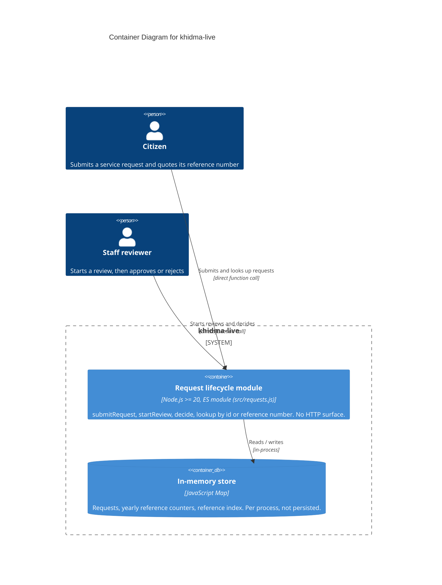

<!-- Source: ApexYard · templates/architecture/c4-container.md · github.com/me2resh/apexyard · MIT -->

# Container Diagram — khidma-live

> **C4 Level 2** — the system broken down into deployable/runnable containers. Audience: the dev team. One diagram per managed project; usually zoomed in from the L1 context diagram.

## Diagram

> **Note**: this diagram was auto-generated by /handover on 2026-10-15 from repo signals (package.json, docker-compose.yml, Dockerfile, Prisma schema, .env.example). It is a **starting point** — review and refine.
>
> - Container labels and tech strings — the detector may have picked a framework version wrong
> - Inferred relationships — user → web assumes HTTPS; adjust if your stack uses something else
> - External systems — anything your team uses that isn't in package.json (e.g. infra-only dependencies, direct cloud APIs called via HTTP) won't have been detected
>
> Update the "Maintenance" section below once the diagram is stable.

## Maintenance

(From the template — update when L2 containers change.)
