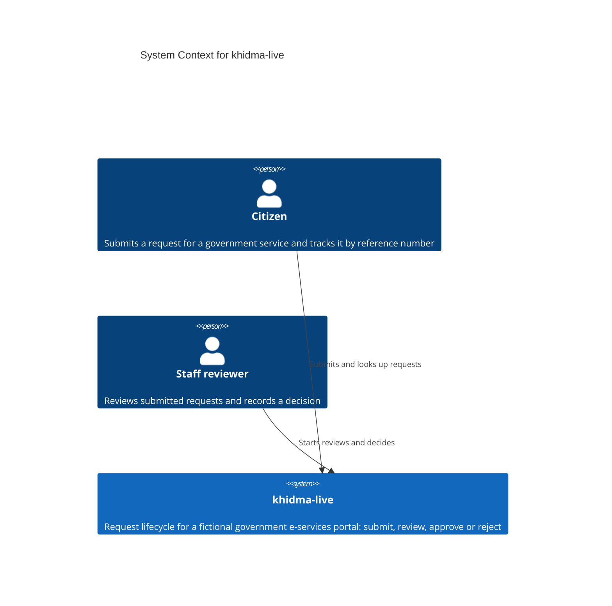

<!-- Source: ApexYard · templates/architecture/c4-context.md · github.com/me2resh/apexyard · MIT -->

# System Context — khidma-live

> **C4 Level 1** — the system and everyone/everything it talks to. Audience: everyone. One diagram per managed project.

## Diagram

> **Note**: this diagram was auto-generated by /handover on 2026-10-15 from repo signals (package.json, README, src/requests.js). It is a **starting point** — review and refine.
>
> - No external systems were detected. The module has zero dependencies and no HTTP, auth, email, or storage integration.
> - Add `System_Ext` boxes when an identity provider, notification channel, or persistent store is introduced.
>
> Update the "Maintenance" section below once the diagram is stable.

## Maintenance

(From the template — update when external relationships change.)
