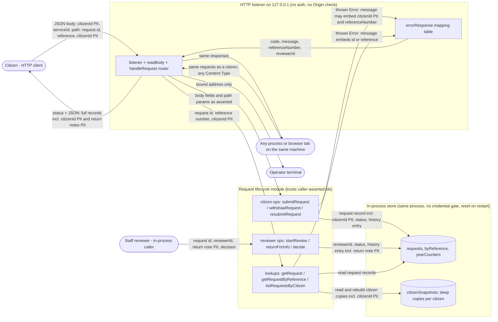

# khidma-live — Data Flow Diagram

> **Source of truth.** This file is the canonical DFD for khidma-live. `/threat-model` and `/compliance-check` consume it instead of regenerating their own. Re-run `/dfd khidma-live` after any architecture change that adds or removes a data store, an external integration, or a trust boundary.

**Generated**: 2026-10-17 by `/dfd` (apexyard), for `main` at `6388ece`
**Format**: Mermaid flowchart (renders inline on GitHub)

**Discovery note.** The grep heuristics in `discover.sh` and `classify.sh` found no routes, stores, or classifications. They do not recognise a plain `node:http` server. Every element below comes from an agent read of `src/server.js` and `src/requests.js`. The operator accepted the model on 2026-10-17 and classified the return note as PII.

**Changes since 2026-10-15.** The HTTP listener from #25 replaces the planned gateway. Withdraw, return for info, and resubmit are new lifecycle actions. The `citizenSnapshots` store from #22 is new. The reviewer actions have no HTTP route yet.

## Diagram

The dashed subgraph borders mark **trust boundaries**. Every arrow that crosses a boundary is a STRIDE candidate. That is where authentication, authorisation, and data-classification rules apply most acutely.

---

## Trust boundaries

| From → To | Authentication | Data classification (most-sensitive crossing) |
|-----------|----------------|-----------------------------------------------|
| Citizen → HTTP listener | None. Loopback TCP only: `startServer` binds `127.0.0.1` (`src/server.js:247`, `:251`). The router accepts any caller (`src/server.js:158`). | citizenId [PII] in JSON bodies and in the `/citizens/:citizenId/requests` path (`src/server.js:101`) |
| Same-machine process or browser tab → HTTP listener | None. No Origin, Host, or Content-Type check. `parseBody` parses any body as JSON (`src/server.js:140`). | Same as the citizen row |
| HTTP listener → citizen or same-machine client | Not applicable (response). Every lookup returns full records. | Full request records incl. citizenId [PII] and return notes [PII]. Error bodies carry the module message (`src/server.js:87`), which can embed a citizenId. |
| HTTP listener → citizen ops and lookups | Same process. Handlers pass body fields and path params straight through (`src/server.js:101`). The module trusts `citizenId` as asserted (`src/requests.js:85`, `:194`, `:221`). | citizenId [PII] |
| Staff reviewer → reviewer ops | None. In-process callers only. No HTTP route exists yet. `reviewerId` is a caller-supplied string (`src/requests.js:168`, `:243`). `decide` does not check the reviewer (`src/requests.js:266`). | Return note [PII], reviewerId [internal] |
| Lifecycle module → in-process store | Same process. No credential gate. Not a network boundary. The store resets on restart. | All request records [PII], including `citizenSnapshots` copies (`src/requests.js:36`) |
| HTTP listener → operator terminal | Not applicable. stdout shows the bound address and startup errors only (`src/server.js:269`). | None |

Each row is a STRIDE entry point. `/threat-model` iterates these crossings rather than inventing threats ad hoc. The first five rows share one root cause: no authentication or authorisation exists anywhere in the codebase. The loopback bind is the only access control.

---

## Data classifications

| Label | Detected element | Pathway | Evidence |
|-------|------------------|---------|----------|
| pii | `request.citizenId` | operator interview, 2026-10-15 (national ID or similar) | `src/requests.js:101` |
| pii | `citizenId` path segment in `GET /citizens/:citizenId/requests` | agent read | `src/server.js:101` |
| pii | `history[].note` (return-for-info note, free text) | operator interview, 2026-10-17 | `src/requests.js:154` |
| pii | `error.message` on `DUPLICATE_REQUEST` and `NOT_REQUEST_OWNER` (embeds a citizenId), returned in HTTP error bodies | agent read | `src/requests.js:91`, `:199`, `:226`; `src/server.js:87` |
| pii | `citizenSnapshots` records (deep copies of citizen requests) | agent read | `src/requests.js:36`, `:134` |
| internal | `request.reviewerId` | operator interview, 2026-10-15 (role or desk id, not a person) | `src/requests.js:258` |
| internal | `request.referenceNumber` (`KH-YYYY-NNNNNN`, a lookup key to a citizenId) | agent read | `src/requests.js:100` |
| internal | `request.serviceId` | agent read | `src/requests.js:102` |
| internal | `request.history[].at` | agent read | `src/requests.js:104` |

No PCI data and no secrets were found. The only env var is `PORT`. The repo has no `.env` file and no runtime dependencies.

`/compliance-check` reads this table to flag cross-border transfers, third-party processors, and PII landing in unencrypted stores. Today the only store is process memory. Persistence is a separate decision (AgDR-0002).

---

## Discovery provenance

- `discover.sh` and `classify.sh` ran on 2026-10-17 against `main` at `6388ece`. Both returned empty sections. See `dfd-source.yaml`.
- Agent read: `src/server.js` (routes, body parsing, error mapping, listener, bind) and `src/requests.js` (exports, store maps, write paths, error messages).
- Operator decisions on 2026-10-17: accept the model as shown, classify the return note as PII, and write the DFD in this repo.

---

## Notes

Each crossing of a trust boundary is where STRIDE threats apply most acutely:

- **Spoofing**: can the source's identity be forged on this hop?
- **Tampering**: can the data be modified in transit or at the receiver?
- **Repudiation**: can the sender deny having sent this?
- **Information disclosure**: what leaks if this hop is intercepted?
- **Denial of service**: what is the failure mode if this hop is overwhelmed?
- **Elevation of privilege**: does crossing this boundary grant more permissions, and are they bounded correctly?

Pair this DFD with `/threat-model` so the boundary table feeds a per-arrow STRIDE enumeration. Pair it with `/compliance-check` so the classifications table feeds cross-border-transfer and DPA-coverage analysis.

---

_Generated by `/dfd` on 2026-10-17. Re-run `/dfd khidma-live` after architecture changes._
