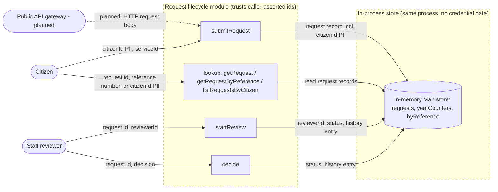

# khidma-live — Data Flow Diagram

> **Source of truth.** This file is the canonical DFD for khidma-live. `/threat-model` and `/compliance-check` consume it instead of regenerating their own. Re-run `/dfd khidma-live` after any architecture change that adds / removes a data store, external integration, or trust boundary.

**Generated**: 2026-10-15 by `/dfd` (apexyard)
**Format**: Mermaid flowchart (renders inline on GitHub) — also available as Threat Dragon JSON via `/dfd khidma-live --format=dragon`

**Discovery note.** The grep heuristics in `discover.sh` and `classify.sh` found no HTTP routes, SDK imports, schema files, or env vars. The module has zero dependencies and no I/O. The operator confirmed every element below during the `/dfd` interview on 2026-10-15. The "Public API gateway (planned)" actor and its boundary do not exist in code. The operator added them to mark the future surface.

## Diagram



The dashed subgraph borders mark **trust boundaries**. Every arrow that crosses a boundary is a STRIDE candidate — that's where authentication, authorisation, and data-classification rules apply most acutely. The dotted arrow from the planned gateway is not a current data flow.

---

## Trust boundaries

| From | To | Authentication | Data classification (most-sensitive crossing) |
|------|-----|----------------|-----------------------------------------------|
| Citizen → submitRequest | None. The module trusts `citizenId` as asserted by the caller (`src/requests.js:49`). | citizenId [PII], serviceId [internal] |
| Citizen → lookup | None. Any caller can read any request by id, reference number, or citizenId (`src/requests.js:74`, `:80`, `:87`). | Full request records including citizenId [PII] |
| Staff reviewer → startReview | None. `reviewerId` is a caller-supplied string (`src/requests.js:97`). The capacity limit keys on it. | reviewerId [internal] |
| Staff reviewer → decide | None. `decide` does not check which reviewer calls it (`src/requests.js:115`). | decision [internal] |
| Module → In-memory store | Same process. No credential gate. Not a network boundary. | All request records [PII] |
| Public API gateway (planned) → submitRequest | Planned. No HTTP layer exists. Authentication design is open. | Planned: HTTP request body carrying citizenId [PII] |

Each row is a STRIDE entry point — `/threat-model` iterates these crossings rather than inventing threats ad-hoc. The first four rows share one root cause: no authentication or authorisation exists anywhere in the codebase.

---

## Data classifications

| Label | Detected element | Pathway | Evidence |
|-------|------------------|---------|----------|
| pii | `request.citizenId` | operator interview (national ID or similar) | `src/requests.js:64` |
| pii | `error.message` on `DUPLICATE_REQUEST` (embeds citizenId and referenceNumber) | agent read | `src/requests.js:55` |
| internal | `request.reviewerId` | operator interview (role or desk id, not a person) | `src/requests.js:111` |
| internal | `request.referenceNumber` (`KH-YYYY-NNNNNN`, a lookup key to a citizenId) | agent read | `src/requests.js:63` |
| internal | `request.serviceId` | agent read | `src/requests.js:65` |
| internal | `request.history[].at` | agent read | `src/requests.js:91` |

No PCI data and no secrets were found. The repo has no env vars, no `.env` file, and no dependencies.

`/compliance-check` reads this table to flag cross-border transfers, third-party processors, and PII landing in unencrypted stores. Today the only store is process memory. Persistence is undecided (see the handover assessment).

---

## Discovery provenance

The candidate model was assembled from the following evidence. The structured report is also stored at `dfd-source.yaml` beside this file for re-run diffs.

### From `discover.sh` (six-axis scan)

```yaml
# DFD discovery report
# Target: /Users/ahmed/demo/ops/workspace/khidma-live
# Scope hint: khidma-live
# Generated: 2026-10-15T18:43:13Z

actors:

processes:

stores:

flows:

boundaries:

classifications:
  # populated by classify.sh — invoke separately for the heuristic walk
```

### From `classify.sh` (data-classification heuristics)

```yaml
classifications:
```

### From the agent read and operator interview

See `dfd-source.yaml` for the full enriched model: 3 actors, 4 processes, 1 store, 9 flows, 2 boundaries (1 present, 1 planned), 6 classified elements.

---

## Notes

Each crossing of a trust boundary is where STRIDE threats apply most acutely:

- **Spoofing** — can the source's identity be forged on this hop?
- **Tampering** — can the data be modified in transit / at the receiver?
- **Repudiation** — can the sender deny having sent this?
- **Information disclosure** — what leaks if this hop is intercepted?
- **Denial of service** — what's the failure mode if this hop is overwhelmed?
- **Elevation of privilege** — does crossing this boundary grant additional permissions, and are those bounded correctly?

Pair this DFD with `/threat-model` so the boundary table feeds directly into a per-arrow STRIDE enumeration. Pair with `/compliance-check` so the classifications table feeds directly into cross-border-transfer and DPA-coverage analysis.

---

_Generated by `/dfd` on 2026-10-15. Re-run `/dfd khidma-live` after architecture changes._
